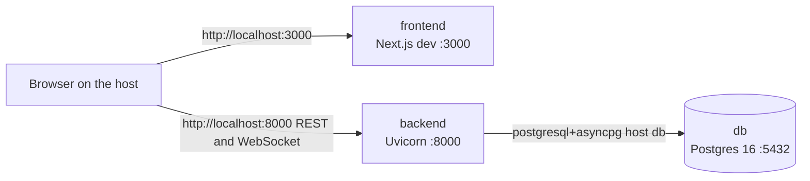

# QueryNest — Infra

[](https://www.docker.com/)
[](https://docs.docker.com/compose/)
[](https://www.postgresql.org/)
[](https://fastapi.tiangolo.com/)
[](https://nextjs.org/)

Docker Compose for running [QueryNest](https://github.com/raosam23/query-nest-frontend) on one machine. The stack is PostgreSQL 16, the [FastAPI + LangGraph backend](https://github.com/raosam23/query-nest-backend), and the [Next.js frontend](https://github.com/raosam23/query-nest-frontend).

A signed-in user asks one question. The API stores a research session and runs a LangGraph pipeline that searches the web, scores each source, fact-checks the claims, and writes a report. A WebSocket streams agent progress while that run is in flight. Screenshots of sign-in, history, live agent rows, and a finished report are in the frontend README: [Screenshots](https://github.com/raosam23/query-nest-frontend#screenshots).

This repository holds `docker-compose.yml` and the env template for that local stack. Application code stays in the other two repositories.

## The stack

`docker-compose.yml` defines three services on the default Compose network. Compose names each service as a DNS hostname, so the backend reaches Postgres at `db`.



The browser on the host talks to the published ports. In the frontend repo, `src/lib/api.ts` calls `http://localhost:8000`, and `src/app/research/[id]/page.tsx` opens `ws://localhost:8000/research/{id}/stream`.

| Service | Build or image | Host port | Container command | Depends on |
| --- | --- | --- | --- | --- |
| `db` | `postgres:16` | `5432` | Postgres entrypoint | — |
| `backend` | `../backend` | `8000` | Image `CMD`: `uv run uvicorn app.main:app --host 0.0.0.0 --port 8000 --reload` | `db` |
| `frontend` | `../frontend` | `3000` | Image `CMD`: `npm run dev` (`next dev` on port 3000) | `backend` |

`docker-compose.yml` leaves `command` unset, so each app container runs the `CMD` from its Dockerfile. The backend Dockerfile is in [query-nest-backend](https://github.com/raosam23/query-nest-backend). The frontend Dockerfile is in [query-nest-frontend](https://github.com/raosam23/query-nest-frontend). `depends_on` waits until the dependency container has started. Postgres can still be starting up, and a backend container that exits stays stopped. See [Database is not ready](#database-is-not-ready).

### `db`

- Image `postgres:16`.
- `POSTGRES_USER` `postgres`, `POSTGRES_PASSWORD` `postgres`, `POSTGRES_DB` `querynest`. These three values are literals in `docker-compose.yml`.
- Publishes `5432:5432`.
- Named volume `postgres_data` mounted at `/var/lib/postgresql/data`.

### `backend`

- Build context `../backend` (the `Dockerfile` in that directory).
- Publishes `8000:8000`.
- Loads `../backend/.env` through `env_file`.
- Sets `DATABASE_URL=postgresql+asyncpg://postgres:postgres@db:5432/querynest`. A value in the env file with the same name is replaced by this one.
- Bind-mounts `../backend` at `/app`, so host edits are the code Uvicorn reloads.
- On startup the app runs `init_db`, which creates tables with `SQLModel.metadata.create_all`. Rows already in `postgres_data` stay in place.

The image build installs dependencies under `/app/.venv`. The bind mount replaces `/app`, which hides that environment. The first `uv run` then creates `.venv` in the cloned backend tree, and later starts reuse it. The backend `.gitignore` ignores `.venv`.

### `frontend`

- Build context `../frontend` (the `Dockerfile` in that directory).
- Publishes `3000:3000`.
- Bind-mounts `../frontend` at `/app`.
- Mounts an anonymous volume at `/app/node_modules`, so the modules installed in the image stay in place when the source tree is mounted.
- The service has no `env_file` and no `environment` block. The API origin is the hardcoded `localhost:8000` URL above.

## Prerequisites

- Git
- Docker Engine with the Compose v2 plugin (`docker compose`). [Docker Desktop](https://www.docker.com/products/docker-desktop/) includes it.
- Host ports `5432`, `8000`, and `3000` free
- An OpenAI API key and a Tavily API key. The backend reads both while importing the app.

## Clone the three repos

Compose resolves `../backend` and `../frontend` from the directory that contains `docker-compose.yml`. Those sibling directories must use those names. The parent folder name can be anything.

```text
querynest/
├── backend/     # github.com/raosam23/query-nest-backend
├── frontend/    # github.com/raosam23/query-nest-frontend
└── infra/       # this repo (docker-compose.yml)
    ├── docker-compose.yml
    ├── .env.example
    └── README.md
```

```bash
mkdir querynest
cd querynest
git clone https://github.com/raosam23/query-nest-backend backend
git clone https://github.com/raosam23/query-nest-frontend frontend
git clone https://github.com/raosam23/query-nest-infra infra
```

If this repo is already cloned under a different folder name, clone the other two next to it as `backend` and `frontend`.

## Environment variables

From the infra directory, copy the example into the file the backend service loads:

```bash
cd infra
cp .env.example ../backend/.env
```

Replace `JWT_SECRET`, `OPENAI_API_KEY`, and `TAVILY_API_KEY`. The placeholders are enough for the process to start. A placeholder OpenAI or Tavily key fails later, when a research run calls that API.

The backend repository has its own `.env.example` for running the API on the host. That file's `DATABASE_URL` uses `localhost`. Under Compose, the `environment` entry on `backend` replaces it with `postgresql+asyncpg://postgres:postgres@db:5432/querynest`.

| Variable | Read from | Required | Purpose |
| --- | --- | --- | --- |
| `DATABASE_URL` | Compose `environment` (overrides `../backend/.env`) | Yes | `postgresql+asyncpg://postgres:postgres@db:5432/querynest` |
| `JWT_SECRET` | `../backend/.env` | Yes | HMAC secret for access tokens |
| `JWT_ALGORITHM` | `../backend/.env` | No | Algorithm for python-jose. Default `HS256` |
| `JWT_EXPIRE_MINUTES` | `../backend/.env` | No | Access-token lifetime. Default `60` |
| `OPENAI_API_KEY` | `../backend/.env` | Yes | Key for the chat model. Required at import |
| `TAVILY_API_KEY` | `../backend/.env` | Yes | Key for web search. Required at import |
| `POSTGRES_USER` | Compose file | Fixed | `postgres` |
| `POSTGRES_PASSWORD` | Compose file | Fixed | `postgres` |
| `POSTGRES_DB` | Compose file | Fixed | `querynest` |

The frontend service has no environment entries. A `.env` file in this infra directory stays unused: `docker-compose.yml` contains no `${VAR}` substitution, so Compose has nothing to interpolate from it.

## Start, stop, logs, reset

Run these from the directory that contains `docker-compose.yml`.

```bash
docker compose up --build
```

The first start pulls `postgres:16` and builds both app images. Uvicorn and `next dev` keep running in the foreground. Add `-d` to detach.

| URL | What it is |
| --- | --- |
| http://localhost:3000 | Frontend |
| http://localhost:8000 | API |
| http://localhost:8000/docs | Swagger UI |
| http://localhost:8000/redoc | ReDoc |
| http://localhost:8000/health | `{"status": "ok"}` |

| Command | What it does |
| --- | --- |
| `docker compose up --build` | Rebuild the app images and start `db`, `backend`, and `frontend` |
| `docker compose up --build -d` | Same, in the background |
| `docker compose up` | Start the stack. Compose builds an image that is missing |
| `docker compose ps` | Status of the three services |
| `docker compose logs` | Logs from all three services |
| `docker compose logs -f backend` | Follow one service (`db`, `backend`, or `frontend`) |
| `docker compose stop` | Stop the containers. The database volume stays |
| `docker compose down` | Stop and remove the containers and the network. `postgres_data` stays |
| `docker compose down -v` | Also remove `postgres_data` and the frontend `node_modules` volume |
| `docker compose restart backend` | Run the API container again after a failed boot |

`docker compose down -v` deletes every row. The next `docker compose up` creates an empty database, and the backend creates the tables again on startup.

The backend engine logs each SQL statement, so `docker compose logs backend` is verbose while the app is up.

## Troubleshooting

### Port already in use

Compose publishes `5432`, `8000`, and `3000` on the host. If one is taken, the daemon reports that the port is already allocated and that service does not start. A local Postgres, a host Uvicorn, or another Next.js dev server is the usual occupant.

Stop the other process, or change the host side of that mapping in `docker-compose.yml` (the number on the left). Keep the backend host port at `8000` so it matches the `localhost:8000` URLs in the frontend source.

### Database is not ready

`backend` lists `depends_on: db` with no healthcheck. Compose moves on once the Postgres container has started, which can be before it accepts connections. The API creates tables during startup. If that connection fails, Uvicorn exits and the backend container stays stopped.

Wait until the database log shows that it is ready to accept connections:

```bash
docker compose logs db
docker compose restart backend
```

`docker compose ps` then shows `backend` as running. `curl http://localhost:8000/health` returns `{"status": "ok"}`.

### `../backend/.env` is missing or incomplete

Compose stops before it creates containers when `../backend/.env` is not there. Copy `.env.example` to that path.

If `JWT_SECRET`, `OPENAI_API_KEY`, or `TAVILY_API_KEY` is absent, the backend process exits while loading settings. The validation error in `docker compose logs backend` names the missing field. `JWT_ALGORITHM` and `JWT_EXPIRE_MINUTES` can be omitted. They default to `HS256` and `60`.

### Build context not found

`docker compose up --build` fails when `../backend` or `../frontend` is missing. Those paths are relative to `docker-compose.yml`. The sibling clones have to be named `backend` and `frontend`.
